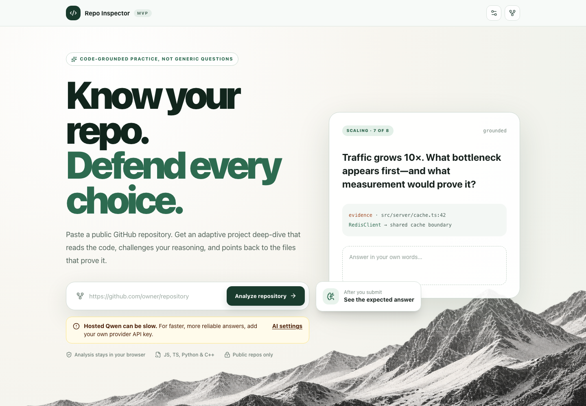
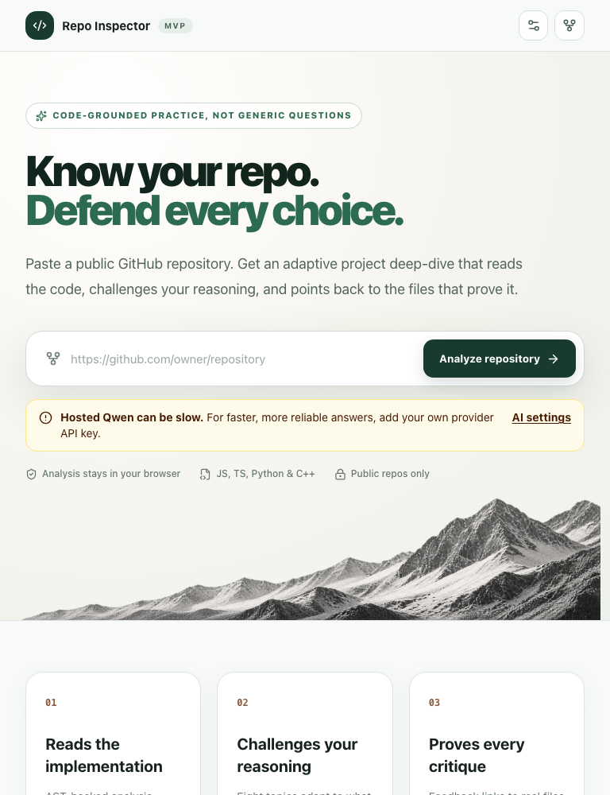
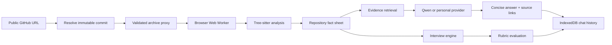

<div align="center">

# Repo Inspector

### Know your repository. Defend every engineering choice.

[](https://repo-inspector.amitsingh003official.workers.dev)
[](#verification)
[](#verification)

**A privacy-first, code-grounded repository analysis and interview practice platform.**

Paste a public GitHub repository to map its architecture, explore implementation details, practice adaptive system-design questions, and chat with evidence selected from the actual codebase.

[Open the live app](https://repo-inspector.amitsingh003official.workers.dev) · [Run locally](#local-development) · [Security model](#security-and-privacy)

</div>



## Why Repo Inspector?

Generic interview questions do not test whether you understand the software you actually built. Repo Inspector analyzes a repository at an immutable commit and turns its real modules, routes, dependencies, tests, infrastructure, and data flow into an evidence-backed learning experience.

- **Inspect before asking** — syntax-aware analysis builds a structured repository fact sheet.
- **Practice eight engineering angles** — architecture, data flow, scalability, reliability, security, testing, trade-offs, and operations.
- **Ask the repository** — conversational answers are grounded in ranked code evidence and keep citations separate from the prose.
- **Challenge your reasoning** — answers receive rubric-based feedback and concise expected-answer examples.
- **Stay private by design** — analysis and chat history remain in the browser; provider keys entered by users are memory-only.

## Product screenshots

<table>
  <tr>
    <td width="72%"></td>
    <td width="28%"></td>
  </tr>
  <tr>
    <td align="center"><strong>Desktop</strong></td>
    <td align="center"><strong>Compact layout</strong></td>
  </tr>
</table>

## Core capabilities

| Area | What it does |
| --- | --- |
| Repository ingestion | Resolves a public GitHub URL, pins the default branch to an immutable commit, and downloads a validated archive. |
| Code analysis | Runs Tree-sitter WASM for JavaScript, TypeScript/TSX, and Python, plus lightweight symbol extraction for C++, inside a browser worker. |
| Repository briefing | Maps languages, frameworks, entry points, imports, routes, dependencies, tests, data stores, CI, and deployment signals. |
| Adaptive interview | Generates eight repository-specific topics with follow-ups based on the candidate's previous answer. |
| Ask Repo chat | Retrieves relevant code evidence, supports multiple saved conversations, and renders clean answers with separate source links. |
| Evaluation | Grades answers against explicit rubric points and produces feedback, expected answers, and revision cards. |
| Local persistence | Stores sessions and chat history in IndexedDB with resume, export, delete, and clear-data controls. |
| AI providers | Uses hosted Qwen by default and supports personal OpenAI, Anthropic, or Gemini keys. |

## How it works



Repository parsing happens client-side. Only selected evidence snippets and current conversation context are sent to the configured AI provider.

## Technology stack

<p>
  
  
  
  
  
  
  
  
  
</p>

## Local development

### Prerequisites

- Node.js 22.13 or newer
- npm
- Git

### Setup

```bash
git clone https://github.com/ampratapsingh/repo-interview-coach.git
cd repo-interview-coach
npm ci
cp .env.example .env.local
npm run dev
```

Open [http://127.0.0.1:5173](http://127.0.0.1:5173).

### Environment variables

```dotenv
# Hosted fallback provider
QWEN_API_KEY=your_qwen_key
QWEN_BASE_URL=https://api.iteracompute.com/v1
QWEN_MODEL=qwen/qwen3.8-27b

# Optional server-side Gemini fallback
GEMINI_API_KEY=your_gemini_key
```

Never commit `.env.local`, `.dev.vars`, or provider credentials. The repository includes only a safe `.env.example` template.

## Available scripts

| Command | Purpose |
| --- | --- |
| `npm run dev` | Start the Vinext development server with HMR. |
| `npm run build` | Produce the Cloudflare Worker and client assets in `dist/`. |
| `npm start` | Preview the production Worker locally with Wrangler. |
| `npm run lint` | Run ESLint across the application. |
| `npm test` | Run the Vitest suite once. |
| `npm run db:generate` | Generate optional Drizzle migrations. |

## Project structure

```text
app/
├── api/                 # GitHub proxy and AI endpoints
├── coach-app.tsx        # Main product experience
├── globals.css          # Design system and responsive styling
└── page.tsx             # Public application entry
lib/
├── analyzer.ts          # Repository signal extraction
├── archive.ts           # Safe archive validation
├── question-engine.ts   # Deterministic interview planning
├── repo-qa.ts           # Evidence retrieval and ranking
├── rate-limit.ts        # AI request rate limiting
└── storage.ts           # Browser-local persistence
workers/
└── analyzer.worker.ts   # Off-main-thread Tree-sitter analysis
public/parsers/          # Tree-sitter WASM grammars
tests/                   # Unit and behavior tests
worker/                  # Cloudflare Worker entrypoint
```

## API surface

| Endpoint | Method | Responsibility |
| --- | --- | --- |
| `/api/github/resolve` | `POST` | Validate a GitHub repository and resolve its immutable head commit. |
| `/api/github/archive/:owner/:repo/:sha` | `GET` | Proxy a size-limited repository archive without persistent storage. |
| `/api/ai/ask` | `POST` | Answer a repository question using selected evidence. |
| `/api/ai/evaluate` | `POST` | Evaluate an interview answer against repository-specific rubric points. |

## Security and privacy

- Only public GitHub repositories are supported.
- Repository owner, name, and commit parameters are validated before upstream requests.
- Compressed archives are capped at 20 MB and are never persisted by the server.
- Repository parsing runs in a browser worker rather than on the application server.
- Personal provider keys stay in browser memory and are not written to IndexedDB or local storage.
- Hosted provider secrets are stored as encrypted Cloudflare Worker secrets.
- AI endpoints validate request shapes with Zod and apply per-client rate limiting.
- AI output is checked against supplied evidence and rubric identifiers before rendering.
- `.env*`, `.dev.vars*`, build output, Wrangler state, certificates, and local tooling state are excluded by `.gitignore`.

> [!IMPORTANT]
> The hosted Qwen endpoint is intentionally available to visitors and is rate-limited. For a high-traffic production deployment, replace the in-memory limiter with Cloudflare Rate Limiting or Durable Objects and configure provider-side budget alerts.

## Deployment

The production application runs on Cloudflare Workers:

**[repo-inspector.amitsingh003official.workers.dev](https://repo-inspector.amitsingh003official.workers.dev)**

```bash
npm run build
npx wrangler secret bulk .env.local --config dist/server/wrangler.json --name repo-inspector
npx wrangler deploy --config dist/server/wrangler.json --name repo-inspector
```

Do not place secret values in `wrangler.json`, shell history, CI logs, or source control. Configure them with Wrangler secrets or the Cloudflare dashboard.

## Verification

The current production revision passes:

```text
✓ ESLint
✓ 4 test files
✓ 18 tests
✓ Vinext production build
✓ Cloudflare Workers deployment
```

Run the complete local verification sequence with:

```bash
npm run lint && npm test && npm run build
```

## Current scope

Repo Inspector currently targets public repositories and JavaScript, TypeScript/TSX, Python, and C++ analysis. Private repositories, Git history analysis, organization accounts, and durable server-side user storage are intentionally outside the current release.

---

<div align="center">
  Built to turn <em>“I wrote it”</em> into <strong>“I can defend every decision.”</strong>
</div>
